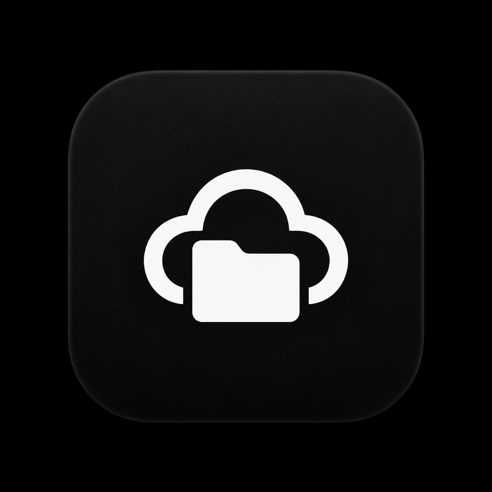

<div align="center">



# Nuvio

**Your files. Everywhere.**

A minimalist, Windows-first unified storage application — written entirely in Rust — powered by its underlying core engine, **Synora**.

[](https://www.rust-lang.org/)
[](https://github.com/emilk/egui)
[](https://www.sqlite.org/)
[](https://www.microsoft.com/windows)

</div>

---

## What is Nuvio?

Nuvio lets you manage files stored across multiple platforms through one simple desktop interface. Instead of building new storage infrastructure, it integrates with providers you already use:

| Provider | Transport | Status |
| -------- | --------- | ------ |
| **GitHub** | Git over SSH | Planned (Phase 2) |
| **YouTube** | Google OAuth + YouTube Data API v3 | Planned (Phase 4) |

Users should not need to understand Git repositories, SSH commands, OAuth flows, or API quotas. Nuvio handles those details internally and presents a simple, reliable file-management experience.

**Nuvio is the product. Synora is the engine. Rust is the implementation language. Windows is the initial platform.**

## What Nuvio will do

One clean desktop app for files that today live scattered across services:

- **Unified file browser** — navigate folders, list and search files from every connected provider in one place, with recent files and favourites.
- **Connect GitHub** — link a private repository over SSH. Nuvio generates and protects SSH keys, verifies host keys, and manages clone, commit, push, and pull for you — no terminal required.
- **Connect YouTube** — link a Google account with OAuth and use YouTube as video storage. Nuvio tracks video IDs and processing state, and is honest that the YouTube API cannot return your original files for download.
- **Uploads and downloads** — send files or whole folders to the right provider, watch per-file progress in a persistent transfer queue, and recover automatically after interruptions or app restarts.
- **Automatic uploads** — optionally queue folders and let the scheduler upload eligible files in the background while Nuvio is running.
- **Smart routing** — images, documents, and text go to GitHub; videos intended for playback go to YouTube — with clear explanations when a file cannot be stored where you expect, including GitHub's file-size limits.
- **Settings that stay out of your way** — theme, provider connections, transfer behaviour, and security status in one compact panel.
- **Local-first index** — a fast SQLite index of your files lives on your machine; credentials stay in Windows Credential Manager, never in plaintext or inside repositories.

## Architecture

Strict separation between the product and its engine:

- **Nuvio** — the desktop application: file browsing, search, previews, transfers UI, account connections, settings, notifications. Built with **egui/eframe**.
- **Synora** — the core engine: storage-provider abstraction, file indexing, metadata, routing, upload scheduling, transfer management, retry/recovery. **No UI dependencies** — usable independently of the graphical interface.

```
nuvio/
├── crates/
│   ├── nuvio-app/         # Windows entry point (eframe)
│   ├── nuvio-ui/          # egui interface — Nuvio product layer
│   ├── synora-core/       # engine boundary, services, errors
│   ├── synora-database/   # SQLite index + migrations
│   ├── synora-storage/    # provider abstraction (future)
│   ├── synora-github/     # GitHub via SSH + Git (future)
│   ├── synora-youtube/    # YouTube via OAuth + Data API (future)
│   └── synora-auth/       # secure credential storage (future)
├── assets/
├── docs/
└── UI/                    # design references and brand assets
```

## Technology

| Component | Choice |
| --------- | ------ |
| Language | Rust (stable) |
| Desktop GUI | egui + eframe |
| Database | SQLite via rusqlite |
| Serialization | Serde |
| Logging | tracing |
| Errors | thiserror |
| Platform | Windows 10 / 11 |

## Design philosophy

Minimal navigation. Small, consistent controls. Light theme by default with an optional dark mode. Blue-violet accent on neutral backgrounds. Compact information density, thin borders, subtle states. No dashboards full of cards, gradients, or decorative clutter — a carefully designed desktop utility.

## Development status

| Phase | Scope | Status |
| ----- | ----- | ------ |
| 0 | Repository inspection & planning | Complete |
| 1 | Desktop foundation (workspace, UI shell, theme, SQLite, logging) | In progress |
| 2 | GitHub integration (SSH + Git) | Not started |
| 3 | Synora transfer engine | Not started |
| 4 | YouTube integration (OAuth + Data API) | Not started |
| 5 | Automation & reliability | Not started |
| 6 | Production polish & installer | Not started |

See [docs/ROADMAP.md](docs/ROADMAP.md) for details.

## Building

Prerequisites:

- [Rust](https://rustup.rs/) (stable, MSVC toolchain)
- Windows 10 or 11

```powershell
git clone https://github.com/DeepanshuK2002/NUVIO.git
cd NUVIO
cargo build --release
cargo run --release
```

Run checks:

```powershell
cargo fmt --check
cargo clippy --workspace
cargo test --workspace
```

## Data & privacy

- Local metadata index: `%APPDATA%\Nuvio\nuvio.db`
- Logs: `%LOCALAPPDATA%\Nuvio\logs`
- Credentials belong in Windows Credential Manager — never in plaintext config files or the repository.

Details: [docs/SECURITY.md](docs/SECURITY.md).

## Documentation

- [docs/ARCHITECTURE.md](docs/ARCHITECTURE.md) — structural decisions and crate boundaries
- [docs/SECURITY.md](docs/SECURITY.md) — security requirements and practices
- [docs/CODING_STANDARDS.md](docs/CODING_STANDARDS.md) — Rust engineering standards
- [docs/TESTING_STRATEGY.md](docs/TESTING_STRATEGY.md) — unit, integration, and failure testing
- [docs/ROADMAP.md](docs/ROADMAP.md) — phased development plan

## License

License to be determined. All rights reserved until otherwise stated.

---

<div align="center">

<br>
<sub>Nuvio — powered by Synora</sub>
</div>
